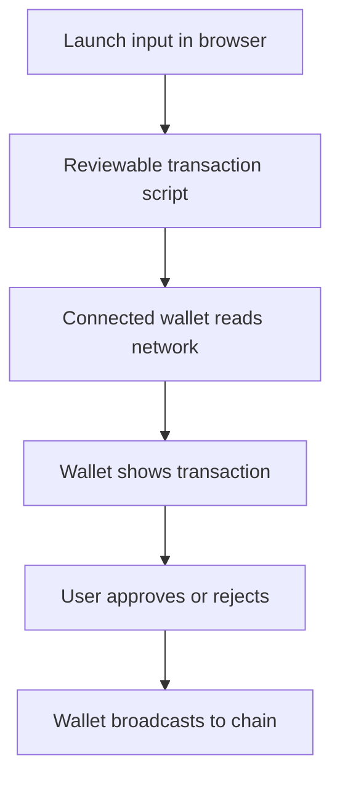

# SonicBlast Smart Launcher

**Sound. Speed. Scale. Direct wallet scripts.**

SonicBlast Smart Launcher is a browser-first multichain launch experience and social floor, powered by **No Doubt Solutions**. Visitors enter a launch profile, and the browser builds a small set of fixed, reviewable transaction scripts. Their own wallet reads the network, shows every transaction, and signs only what they approve.

Project reference: `0x018ea8d2f38f696b2d201a01e5cd04f6272742b7`

## 1.6.0 — API-free chain actions

For deployment, pairing, and the on-site SNBL path, SonicBlast no longer calls a Worker quote endpoint, 0x, an aggregator, or an API-key-backed service.

| Action | Direct wallet-script flow |
| --- | --- |
| Build launch review | Browser validates the form locally. |
| Deploy token | Wallet deploys the embedded reviewed factory if needed, then calls `createToken`. |
| Pair liquidity | Browser creates exact ERC-20 approvals and a reviewed V2 `addLiquidity` transaction. |
| Buy SNBL | Browser reads `getAmountsOut` from the configured V2 router through the wallet, then builds an exact-input V2 swap. |

The wallet still needs its normal RPC connection to the selected blockchain. “API-free” here means SonicBlast does not send those chain actions through its own HTTP API or a third-party quote API. The injected wallet provider carries read calls and signed transactions to the selected network.

## What is included

- Responsive PWA with EVM wallet connection for MetaMask, Coinbase Wallet, and compatible in-wallet browsers; Phantom-compatible connection for Solana.
- Embedded fixed-supply EVM factory and token artifact for user-approved token deployment.
- Self-hosted xterm.js console with allowlisted commands: `help`, `status`, `connect`, `script`, `deploy`, `pair`, and `clear`.
- Direct V2-compatible liquidity pairing from a reviewed, site-bundled configuration.
- Direct V2 on-site SNBL purchase path with an on-chain router read and a wallet-approved swap—no quote API key.
- Sonic IQ launch guidance, creation board, live chat, and direct WebRTC voice/video rooms.
- No recovery phrase, private key, remote terminal, arbitrary Bash, or server-side transaction signer.

## Direct wallet execution



The xterm.js panel is a local visual console and parser, not a Bash process. It never accepts a private key, recovery phrase, remote command, or arbitrary uploaded script.

## Configure reviewed routes

Edit [public/network-config.js](public/network-config.js) before deployment and replace every placeholder only with independently verified addresses. The file is bundled with the site; it is not fetched from a Worker API.

```js
export const SONICBLAST_DIRECT_CONFIG = {
  factories: {
    base: "0xYOUR_REVIEWED_FACTORY_ADDRESS"
  },
  pairing: {
    base: {
      router: "0xYOUR_REVIEWED_V2_ROUTER",
      slippageBps: 100,
      assets: {
        USDC: { address: "0xYOUR_REVIEWED_USDC", decimals: 6 }
      }
    }
  },
  snbl: {
    chain: "base",
    tokenAddress: "0xYOUR_VERIFIED_SNBL",
    tokenSymbol: "SNBL",
    tokenDecimals: 18,
    router: "0xYOUR_REVIEWED_V2_ROUTER",
    wrappedNative: "0xYOUR_REVIEWED_WRAPPED_NATIVE",
    payment: { address: "", symbol: "ETH", decimals: 18 },
    route: [],
    slippageBps: 100
  }
};
```

For an ERC-20 SNBL payment asset, set `payment.address` and its verified decimals. `route` may contain verified intermediate token addresses only; SonicBlast automatically adds the input asset and SNBL endpoint. A blank value keeps a route unavailable.

## Use the browser console

Build a launch profile first, then use the visible buttons or type:

```text
help
status
connect
script deploy
deploy
script pair 100000 0.25
pair 100000 0.25
clear
```

`script` previews the exact local transaction plan without sending it. `deploy` and `pair` open only the wallet approval screens required by the fixed plan. The Buy SNBL panel first performs a read-only V2 router call; it creates a fresh 20-minute swap script before asking for approval.

## Deploy to Cloudflare

```bash
npm install
npm run verify
npx wrangler login
npm run deploy
```

No `ZEROX_API_KEY`, RPC credential, or chain-operation secret is needed for this release. Details and a preflight checklist are in [DEPLOYMENT.md](DEPLOYMENT.md).

## Security and production readiness

- Never add a recovery phrase, seed phrase, private key, wallet password, or raw signing key to SonicBlast, Worker variables, xterm.js, or a form.
- Verify and independently audit the factory, token, exact bundled bytecode, direct V2 router, wrapped native token, every configured asset, and every route before mainnet use.
- Test deployment, liquidity, and direct SNBL swap scripts on the intended testnet before any mainnet transaction.
- The wallet confirmation screen is authoritative. Users must independently inspect chain, router, token addresses, recipient, amounts, minimums, deadline, gas, and transaction value.
- The creation board’s heat is community activity, not a trading signal. Add authentication, moderation, rate limits, disclosures, and legal review before broad public use.

## Project layout

```text
public/                 PWA, self-hosted xterm.js, direct wallet scripts, static route config
src/                    Creation board, rooms, Durable Objects, WebRTC signaling Worker
contracts/evm/          Fixed-supply token and permissionless factory source
scripts/                Deterministic factory-artifact build script
runner/                 Legacy operator tooling; not exposed to public visitors
DEPLOYMENT.md           Cloudflare configuration and verification
SECURITY.md             Security model and mainnet checklist
```
