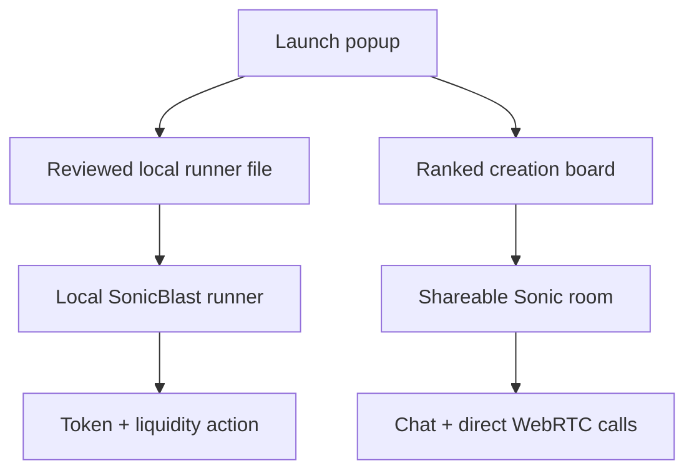

# SonicBlast Smart Launcher

**Sound. Speed. Scale. Smarter launches.**

SonicBlast Smart Launcher is a multichain launch experience and live social floor, powered by **No Doubt Solutions**. It includes Sonic IQ, the in-app operational advisor for a reviewed local runner handoff.

Project reference: `0x018ea8d2f38f696b2d201a01e5cd04f6272742b7`

## Smart Launcher 1.4.0 — what ships in this package

- A responsive browser app and installable PWA using the SonicBlast mark.
- A one-field-at-a-time launch popup for Ethereum, Base, Arbitrum, Optimism, Polygon, BNB Chain, Avalanche, and Solana.
- Sonic IQ, a chain-aware operational readiness advisor for the launch flow and local runner handoff.
- A persistent creation board, ranked by community heat, with creation rooms and buyer links supplied by the launch operator.
- Shareable Sonic rooms with live chat, direct voice calls, and direct video calls.
- Cloudflare Durable Objects for room chat, WebRTC signaling, and the ranked creation registry.
- A local-only CLI runner for EVM token deployment, EVM V2 liquidity provisioning, and Solana token creation.
- A fixed-supply ERC-20 contract with no transfer tax, hidden mint, blacklist, or post-deployment owner controls.

## Product flow



The browser never executes the chain CLI and never receives a wallet recovery phrase or private key. It produces a reviewed local runner handoff; the operator-controlled runner performs the allowlisted CLI work and signs locally.

## Deploy SonicBlast Smart Launcher to Cloudflare

1. Create a new Git repository from this folder and push it to GitHub.
2. In the project folder, run `npm install` and `npm run verify`.
3. Authenticate Wrangler with `npx wrangler login`.
4. Deploy with `npm run deploy`.
5. For Git-connected builds, use:

| Setting | Value |
| --- | --- |
| Root directory | `/` |
| Build command | `npm run verify` |
| Deploy command | `npm run deploy` |

Cloudflare hosts the PWA, the creation registry, and the room services. The local runner stays on the operator device.

## Calls: direct peer connection plus optional TURN

Voice/video rooms use WebRTC. Cloudflare Durable Objects carry only room and signaling events; media travels directly between call members. This works without a relay in friendly network conditions.

For reliable calls across restrictive networks, configure a TURN service that supports the shared-secret TURN REST method. The Worker issues a short-lived credential only when the following values are configured:

| Variable | Set it as | Purpose |
| --- | --- | --- |
| `RTC_ICE_SERVERS_JSON` | Worker variable | Optional STUN server array, with no credentials |
| `TURN_URLS` | Worker variable | JSON array of `turn:` or `turns:` URLs |
| `TURN_SHARED_SECRET` | Wrangler secret | Shared secret for short-lived TURN credentials |

Example public Worker variable values:

```json
RTC_ICE_SERVERS_JSON=[{"urls":["stun:stun.example.com:3478"]}]
TURN_URLS=["turn:turn.example.com:3478?transport=udp","turns:turn.example.com:5349"]
```

Set the secret outside Git:

```bash
npx wrangler secret put TURN_SHARED_SECRET
```

See [DEPLOYMENT.md](DEPLOYMENT.md) for the full production checklist.

## Configure a launch workstation

See [runner/README.md](runner/README.md). The runner supports these production paths:

| Chain family | Token creation | Liquidity workflow |
| --- | --- | --- |
| Ethereum, Base, Arbitrum, Optimism, Polygon, BNB Chain, Avalanche | `forge create` with the included fixed-supply ERC-20 | Generic V2-compatible router script using `cast send` |
| Solana | `spl-token` / Token-2022 CLI | A DEX adapter handoff; configure the selected venue’s audited adapter before use |

Every liquidity venue has its own router or program interface. SonicBlast keeps that decision explicit through per-chain RPC and router settings rather than hardcoding live third-party router addresses.

## Sonic IQ

Sonic IQ is an in-app operational advisor. It evaluates the completed launch setup, identifies the selected chain and liquidity lane, confirms the public-recipient format, calls out metadata state, and names the next local runner action. It is deterministic and uses no wallet secrets, market-price feeds, or trading predictions.

## SNBL buy action

The bright **Buy SNBL** button opens the exact HTTPS market link configured in the Worker variable `SNBL_BUY_URL`. Leave it empty until the approved SNBL market destination is ready; until then, the button takes visitors to the creation board and explains what remains to be configured.

## Liquidity selection

The launch popup lets an operator choose the network token or an approved stablecoin list for the selected chain. Native-token choices create the native-asset V2 handoff. Stablecoin choices create the ERC-20-pair handoff and leave the stablecoin contract or mint address and base-unit amount explicit for the operator to review locally.

## Creation board behavior

Publishing from the launch popup creates a `planned` board item. The creator browser receives a private management capability stored only in that browser, which enables its **Manage** action to add the deployed token address and verified HTTPS market URL later. Only then does the card expose a **Buy** link. SonicBlast does not generate trading destinations or take custody of user funds.

Each browser can add one heat pulse per creation. For a public launch, add account authentication, anti-abuse controls, moderation, and rate limits before treating board ranks as an economic signal.

## Install SonicBlast Smart Launcher

Open the deployed site in a modern browser and choose **Install**. The social experience runs online; the app shell and recent interface assets are cached for a standalone PWA window.

## Project layout

```text
public/                 Browser/PWA interface
src/                    Worker, creation registry, chat, and WebRTC signaling
runner/                 Local launch runner and CLI scripts
contracts/evm/          Fixed-supply ERC-20 contract
DEPLOYMENT.md           Cloudflare and call-relay deployment guide
SECURITY.md             Security controls and production checklist
```
